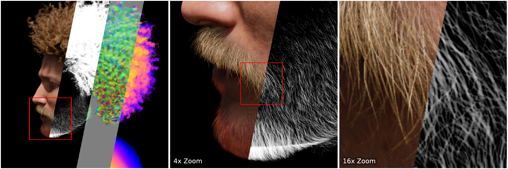
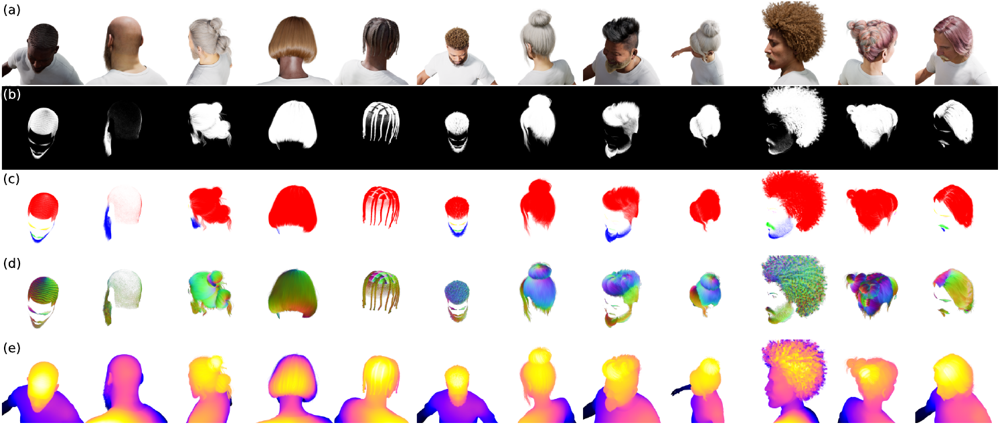

# SynthHair: Leveraging MetaHumans for a High-Quality 4K Hair Matting Dataset

Markus Karmann, Shile Li, Qi Zhang, Peng-Tao Jiang, Bo Li, Puneet K. Dokania, Philip Torr, Onay Urfalioglu



**Abstract**: Recent progress in computer vision enables dense alpha matte predictions at resolutions of 4K and higher. While portrait matting has benefited from large-scale, high-resolution datasets, progress in hair matting remains limited due to the difficulty of annotating sub-pixel fine hair details. In this work, we analyze critical limitations in image resolution and annotation quality of such existing datasets and introduce our own synthetic hair matting dataset, **SynthHair**, which consists of 16k RGBA portrait images in 4096 × 4096 image resolution, containing labels for hair matting, as well as hair categorization, growth direction, and depth estimation. We create this dataset using MetaHuman Creator and Unreal Engine to obtain highly detailed and realistic renders of human faces with complex hair structures. We adapt a generalized version of the isoperimetric inequality quotient (IPQ) that we call the **soft isoperimetric inequality quotient (SIPQ)**, as a scale-invariant label complexity metric that enables comparison of both segmentation and matte labels. Using this metric, we demonstrate that hair matting complexity increases significantly with resolution, reaching an SIPQ of 734.75 at 4K, in contrast with portrait matting datasets at similar resolutions, which reach an SIPQ of ~10. To validate our data, we train separate matting models on SynthHair and existing real-world datasets. Our results demonstrate strong domain generalization and show clear improvements in high-resolution images. A/B testing further confirms this, as our mattes are preferred in at least 85% of comparisons on high-resolution images. Code and data: [https://github.com/mkarmann/synth-hair](https://github.com/mkarmann/synth-hair)

## 📝 Overview

SynthHair is a synthetic 4K hair matting dataset rendered with MetaHuman Creator and Unreal Engine. This repository provides the code to train and run hair matting models, and to estimate the soft isoperimetric inequality quotient (SIPQ) on matte and binary segmentation labels.

## 👤 SynthHair Dataset

SynthHair consists of 16,000 images (14,500 train, 1,500 test) of 43 individual MetaHuman identities (39 train, 4 test).



Each image has several labels. **(a)** Rendered RGBA portrait. **(b)** Hair alpha matte. **(c)** Soft category labels: red scalp hair, yellow eyebrows, pink eyelashes, green mustache, blue beard. **(d)** 3D growth direction: red toward the camera, green to the right, blue up. **(e)** Full-body depth.

The 4096 × 4096 dataset is on the Harvard Dataverse. The 2048 × 2048, 1024 × 1024, and 512 × 512 versions are on Hugging Face:


| Resolution  | Download                                   | Full     | RGBA     | Hair    | Categories | Growth   | Depth    |
| ----------- | ------------------------------------------ | -------- | -------- | ------- | ---------- | -------- | -------- |
| 4096 × 4096 | [link](https://doi.org/10.7910/DVN/KTSTEW) | 867.7 GB | 218.2 GB | 61.4 GB | 66.1 GB    | 122.0 GB | 400.0 GB |
| 2048 × 2048 | [link](https://huggingface.co/datasets/StableMarkus/synth-hair-dataset-2048x2048) | 401.4 GB | 61.0 GB | 18.6 GB | 19.9 GB | 33.3 GB | 268.6 GB |
| 1024 × 1024 | [link](https://huggingface.co/datasets/StableMarkus/synth-hair-dataset-1024x1024) | 101.2 GB | 14.3 GB | 5.2 GB | 5.7 GB | 8.8 GB | 67.2 GB |
| 512 × 512   | [link](https://huggingface.co/datasets/StableMarkus/synth-hair-dataset-512x512) | 25.6 GB | 3.5 GB | 1.4 GB | 1.6 GB | 2.3 GB | 16.8 GB |


### File structure

```text
dataset_root/
├── samples.csv
├── split_train.json
├── split_test.json
├── image/
│   └── 0000000.png
├── hair_matte/
│   └── 0000000.png
├── scalp_hair_matte/
│   └── 0000000.png
├── eyebrows_matte/
│   └── 0000000.png
├── eyelashes_matte/
│   └── 0000000.png
├── mustache_matte/
│   └── 0000000.png
├── beard_matte/
│   └── 0000000.png
├── hair_growing_direction/
│   └── 0000000.png
└── depth/
    └── 0000000.tiff
```

Due to the large size of the dataset, each label folder is packed into 2 GB parts, so that different types of labels can be downloaded as needed. `samples.csv`, the split files, and `unpack.sh` are separate small files. `unpack.sh` joins each `*.tar.part_*` series and extracts it into the layout above. Dataverse provides these files:

```text
dataset_root/
├── unpack.sh
├── samples.csv
├── split_train.json
├── split_test.json
├── image.tar.part_aa
├── image.tar.part_ab
├── ...
├── hair_matte.tar.part_aa
├── ...
├── scalp_hair_matte.tar.part_aa
├── ...
├── eyebrows_matte.tar.part_aa
├── ...
├── eyelashes_matte.tar.part_aa
├── ...
├── mustache_matte.tar.part_aa
├── ...
├── beard_matte.tar.part_aa
├── ...
├── hair_growing_direction.tar.part_aa
├── ...
├── depth.tar.part_aa
└── ...
```

```bash
cd path/to/dataset_root
bash unpack.sh
```


## 🔧 Installation

The code uses **Python 3.11** and [uv](https://docs.astral.sh/uv/getting-started/installation/).

```bash
git clone https://github.com/mkarmann/synth-hair.git
cd synth-hair
uv sync
```


## 🚀 Using Pre-Trained H2M2 Models

`inference_folder.py` runs inference on a folder of raw images. `hf:matte` is the hair matte model, and `hf:attributes` predicts hair category, 2D orientation, and depth. The released weights are on [StableMarkus/synth-hair-h2m2](https://huggingface.co/StableMarkus/synth-hair-h2m2).

```bash
uv run inference_folder.py --input-path <images_dir> --output-path <out_dir> --ckpt-path hf:matte --device cuda:0
uv run inference_folder.py --input-path <images_dir> --output-path <out_dir> --ckpt-path hf:attributes --device cuda:0
```

Pre-trained models can also be loaded directly as follows:

```python
import sys
sys.path.insert(0, "src")
from model import HairMatteModel, Hair2DAttributesModel

matte = HairMatteModel.from_pretrained("StableMarkus/synth-hair-h2m2", subfolder="matte")
attributes = Hair2DAttributesModel.from_pretrained("StableMarkus/synth-hair-h2m2", subfolder="attributes")
```


## 🎓 Training H2M2

Training reads dataset locations from `configs/paths.yaml`, which can be pointed at your local copies. Only BGMv2 Backgrounds and Clothing are needed for training. The other datasets below are used for evaluation.


| Dataset           | Link                                                                                                                                                   |
| ----------------- | ------------------------------------------------------------------------------------------------------------------------------------------------------ |
| BGMv2 Backgrounds | [https://grail.cs.washington.edu/projects/background-matting-v2/#/datasets](https://grail.cs.washington.edu/projects/background-matting-v2/#/datasets) |
| Clothing          | [https://github.com/alexeygrigorev/clothing-dataset](https://github.com/alexeygrigorev/clothing-dataset)                                               |
| Figaro1k          | [https://www.michelesvanera.org/figaro-1k](https://www.michelesvanera.org/figaro-1k)                                                                   |
| CelebAMask-HQ     | [https://github.com/switchablenorms/CelebAMask-HQ](https://github.com/switchablenorms/CelebAMask-HQ)                                                   |
| HiSa              | [https://drive.google.com/drive/folders/16_wS405x3sTCbIo2rPXr9q6Y_kuS6tk-](https://drive.google.com/drive/folders/16_wS405x3sTCbIo2rPXr9q6Y_kuS6tk-)   |
| Face Synthetics   | [https://github.com/microsoft/FaceSynthetics](https://github.com/microsoft/FaceSynthetics)                                                             |


Training presets live under `configs/train/`. For example:

```bash
uv run train.py --config ./configs/train/Matte512.yaml --device cuda:0
```

On an NVIDIA GeForce RTX 4090, the `Matte512` preset (15 epochs, batch size 1, 14,500 training images) takes about 7.5 hours and 1.5 GB of VRAM. (Training in 4K resolution takes about 20 GB of VRAM)

Once training is finished, inference can be done by simply passing the resulting checkpoint path.

```bash
uv run inference_folder.py --input-path <images_dir> --output-path <out_dir> --ckpt-path <model_latest.pth> --device cuda:0
```


## 📊 Evaluating H2M2

`prepare_evaluation_set.py` exports a SynthHair test split into `images/` and `labels/`. The portraits are composited onto a background. The available sets for SynthHair are SynthHairx512, SynthHairx1024, SynthHairx2048, and SynthHairx4096.

```bash
uv run prepare_evaluation_set.py --dataset SynthHairx4096 --output-path <evaluation_dir>
```

Those images can then be passed through the matte model, and the predictions compared with `evaluate_matte.py`.

```bash
uv run inference_folder.py --input-path <evaluation_dir>/SynthHairx4096/images --output-path <predictions_dir> --ckpt-path hf:matte --device cuda:0
uv run evaluate_matte.py --predictions-path <predictions_dir>/matte --targets-path <evaluation_dir>/SynthHairx4096/labels/matte
```


## 📐 Soft Isoperimetric Inequality Quotient (SIPQ)

SIPQ is introduced in the paper as a measure of label complexity and texture richness. A folder of mattes can be scored with:

```bash
uv run estimate_sipq_folder.py --input-path <mattes_dir>
```


## ⚖️ License

The dataset, code, and released model weights are licensed under [CC BY-NC 4.0](LICENSE). They are for non-commercial, academic research purposes only, and may not be used for any commercial purpose.

The checkpoints contain the unchanged [DINOv2](https://github.com/facebookresearch/dinov2) ViT-S/14 backbone weights from Meta. That backbone stays under the [Apache License 2.0](https://www.apache.org/licenses/LICENSE-2.0). CC BY-NC 4.0 covers the dataset, this code, and the trained heads.

## ❤️ Acknowledgement

Applied MetaHuman powered synthetic data from Epic Games. Contact Epic Games for licensing options.

## 📚 Citation

To appear at NeurIPS 2026.

```bibtex
@inproceedings{karmann2026synthhair,
      title={SynthHair: Leveraging MetaHumans for a High-Quality 4K Hair Matting Dataset},
      author={Markus Karmann and Shile Li and Qi Zhang and Peng-Tao Jiang and Bo Li and Puneet K. Dokania and Philip Torr and Onay Urfalioglu},
      booktitle={Advances in Neural Information Processing Systems},
      year={2026}
}
```

